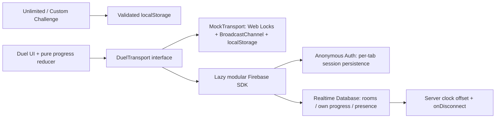

# Custom Wordle

A mobile-friendly Wordle game with the familiar dark tile-and-keyboard interface. Built with React 19, TypeScript and Vite. Three modes:

- **Unlimited:** random solo words, saved boards, Hard Mode, separate statistics, and no immediate answer repeats.
- **2-Player Custom Challenge:** set any valid five-letter word and share an encoded link or four-character code. Opening the link starts a fresh challenge; the answer is obfuscated, not encrypted.
- **Duel (1v1):** share a five-character room code, choose 1/2/5 minutes, both Ready, then race through the same seeded word sequence after a synchronized five-second countdown. Live scores, color-only opponent grids, reconnect, forfeits, results, rematches and local Duel stats are included.

## Local development

Use the Node version in `.nvmrc` (24.12 or newer 24.x).

```sh
nvm use
npm i
npm run dev
```

Open the URL printed by Vite. Without Firebase configuration, development uses `MockTransport`: create a Duel and open its link in **another tab of the same browser profile and origin**. Each tab is a separate player; refreshing that tab restores its identity and board. Mock rooms cannot connect separate phones or browsers. Use Firebase for friends on separate devices.

To choose a transport, copy `.env.example` to `.env.local` and set `VITE_DUEL_TRANSPORT=mock` or `firebase`. The Firebase SDK loads only when Firebase Duel is used. A production build without Firebase configuration displays a friendly setup message. See [realtime setup](docs/SETUP_REALTIME.md) for every environment variable and exact console steps.

## Scripts and checks

| Command                | Purpose                                                             |
| ---------------------- | ------------------------------------------------------------------- |
| `npm run dev`          | Vite development server                                             |
| `npm run lint`         | ESLint, zero warnings                                               |
| `npm run typecheck`    | Strict app, config and test typing                                  |
| `npm run test`         | Vitest unit and MockTransport integration tests in CI mode          |
| `npm run test:e2e`     | Chromium browser tests; first run `npx playwright install chromium` |
| `npm run test:rules`   | Firebase Realtime Database emulator rule tests; requires Java 21    |
| `npm run build`        | Production static build to `dist/`                                  |
| `npm run preview`      | Serve the production build locally                                  |
| `npm run format`       | Format source with Prettier                                         |
| `npm run format:check` | Check formatting                                                    |

GitHub Actions runs install, lint, typecheck, tests, build and database security tests on push/PR. Browser checks run locally against two mock clients, including a complete timed match. No production Firebase project is needed for tests.

## Architecture



`src/components` provides reusable board, keyboard and accessible modals. `src/hooks/useGame.ts` owns solo input/reveal/persistence. `src/utils` contains evaluation, checksummed challenge encoding, validated storage and durable stats receipts. `src/duel` separates pure ranking/seed/progress logic from transports, UI and local snapshots. All routes use hashes (`#/unlimited`, `#/play?w=…`, `#/duel`, `#/duel/ABCDE`). Share links use the active origin.

Duel stores only a seed, color patterns, counts and timestamps in shared state. Each player retains guessed letters locally. Countdown, guess acceptance and the timer derive from the transport's clock. Valid Enter submissions count immediately; invalid guesses and submissions at/after the buzzer do not count. Six failed guesses advance to the next word, and keyboard colors reset. Hard Mode is disabled for both Duel players. Solo reveal timing stays at 500 ms with a 300 ms stagger; Duel uses 250 ms with an 80 ms stagger.

Database rules require Auth, prevent listing rooms, enforce two seats, limit writes to each player's own nodes and constrain host lifecycle writes. Read [the rules/setup details](docs/SETUP_REALTIME.md). A determined user can derive answers from the public seed/list or forge their own progress; this is intended for friendly play, not competitive ranked play.

## Grading policy

`rankDuel` compares these metrics strictly in order. The first difference decides:

| Priority | Metric                           | Better  |
| -------- | -------------------------------- | ------- |
| 1        | Words solved                     | More    |
| 2        | Guesses on solved words only     | Fewer   |
| 3        | Time of final solve              | Earlier |
| 4        | Total greens from valid guesses  | More    |
| 5        | Total yellows from valid guesses | More    |
| 6        | All equal                        | Draw    |

If neither player solved a word, final-solve time is null and skipped. Failed/in-progress words still contribute greens and yellows. Forfeit overrides scores. The same pure function computes the result on both clients; results highlight the deciding row and show each word's answer, guesses and elapsed time. Mutual rematch acceptance keeps the room code and duration, changes the seed, and clears effective readiness.

## Deploying to Vercel (later)

This repository is prepared for deployment; **no deployment was performed**.

1. Complete [Firebase setup](docs/SETUP_REALTIME.md): project, web app, Realtime Database, anonymous sign-in and published `database.rules.json`.
2. Import this GitHub repository in Vercel. Choose **Vite**, Node **24.x**, `npm run build` and `dist`.
3. In **Project → Settings → Environment Variables**, set `VITE_DUEL_TRANSPORT=firebase` and every required `VITE_FIREBASE_*` value from `.env.example`.
4. Deploy when ready. Env changes require a rebuild. Add the resulting hostname to Firebase Auth authorized domains.
5. Verify a full Duel on two phones.

`vercel.json` includes a SPA fallback; hash share links remain independent of server routing. Icons, standalone web-app manifest, safe-area styling and social preview metadata are included. There is no service worker, avoiding stale game bundles. Social image URLs are made absolute from Vercel build hostname variables. Set optional `VITE_SITE_URL` to your public origin if you use a custom domain or disable system environment variables.

## Operational limits

Rooms expire after six hours; hosts delete them when closing the lobby or leaving results. Optional trusted cleanup is described in the setup guide. Presence detection follows the database's connection event, so the 20-second disconnect grace begins when shared presence changes. Unsent web SDK writes do not survive a reload by themselves; local snapshots recover your progress and retry it. If final scores are still syncing, results can update when queued pre-buzzer guesses arrive, and the statistics receipt waits for confirmed final data.

See [the audit](docs/AUDIT.md) for fixed bugs, checks and measured build sizes.
